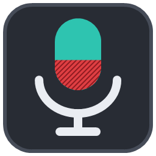
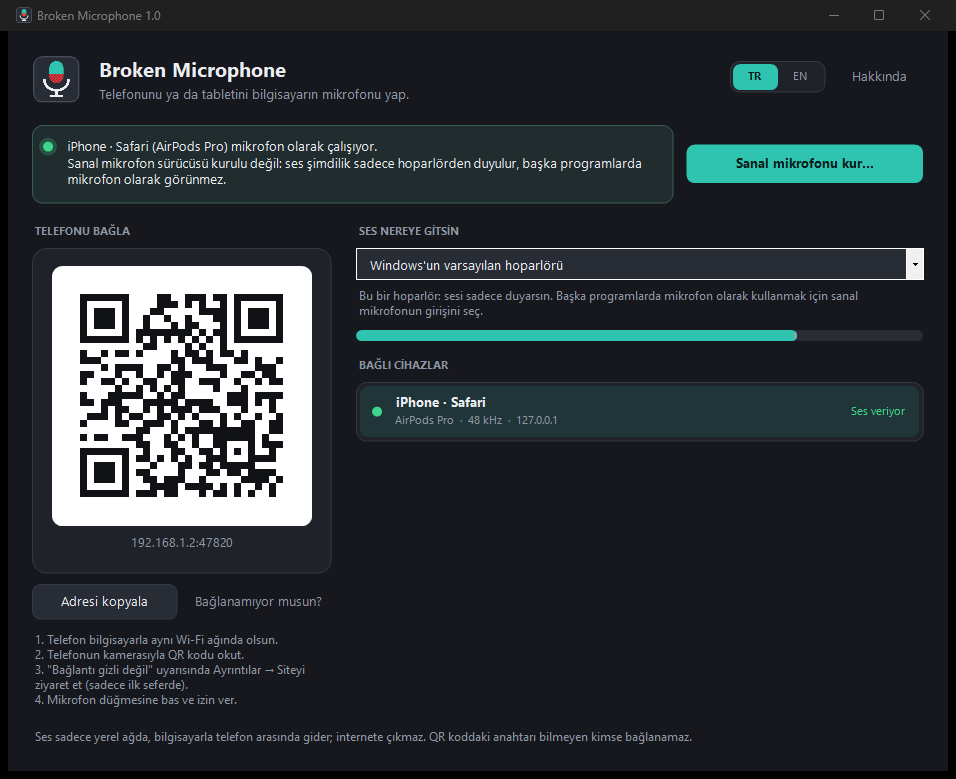
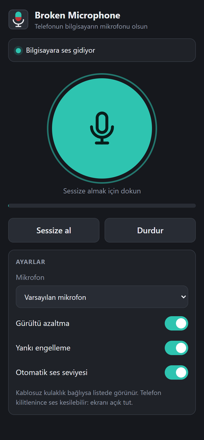
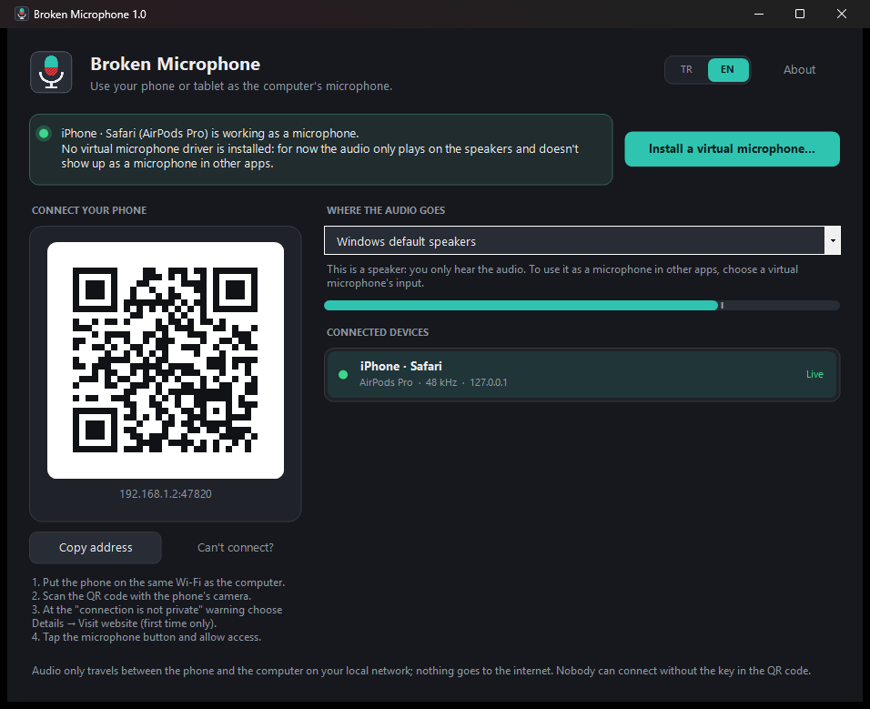

<h1 align="center">Broken Microphone</h1>

<b>Bilgisayarının mikrofonu yok ya da bozuk mu? Telefonunu mikrofon yap.</b> 
Telefonun, tabletin ya da onlara bağlı kablosuz kulaklık, Wi-Fi üzerinden bilgisayarın mikrofonu olur. Telefona uygulama kurman gerekmez: QR kodu okut, tarayıcıda açılan sayfada mikrofona bas.

<a href="#english">English</a> · <a href="https://github.com/HErkanuzun/BrokenMicrophone/releases/latest">İndir / Download</a> · <a href="CHANGELOG.md">Sürüm geçmişi</a>

## Nasıl çalışır

1. Bilgisayarda **Broken Microphone**'u aç. Pencerede bir QR kod görünür.
2. Telefon bilgisayarla **aynı Wi-Fi ağında** olsun. Telefonun kamerasıyla QR kodu okut.
3. İlk seferde tarayıcı **"bağlantı gizli değil"** der. Normaldir: sayfanın güvenlik sertifikasını bilgisayarın kendisi üretti, bir şirket onaylamadı. iPhone'da *Ayrıntıları göster → bu web sitesini ziyaret et*, Android'de *Gelişmiş → siteye ilerle*. Bunu sadece bir kez yaparsın.
4. Sayfadaki büyük **mikrofon düğmesine** bas ve izin ver. Ses bilgisayara gitmeye başlar.
5. Discord, Zoom, Teams, OBS ya da oyunda mikrofon olarak **sanal mikrofonu** seç.

**Telefondaki sayfa**
- iPhone, iPad ve Android'de çalışır (Safari, Chrome, Samsung Internet, Edge). Uygulama mağazası ve hesap gerekmez.
- **Kablosuz kulaklık:** telefona bağlı AirPods ya da Bluetooth kulaklık varsa sayfadaki *Mikrofon* listesinde görünür.
- Gürültü azaltma, yankı engelleme ve otomatik ses seviyesi açılıp kapatılabilir.
- **Sessize al** düğmesi; bilgisayardaki pencerede de görünür.
- Ekran açık kalır. Telefon kilitlenirse tarayıcı sesi durdurabilir; sayfaya dönünce kendiliğinden devam eder.

**Bilgisayardaki pencere**
- Bağlı cihazları, hangisinin ses verdiğini ve ses seviyesini gösterir. Birden fazla telefon bağlanabilir; konuşmaya başlayan ya da tıkladığın cihazın sesi kullanılır, sesler karışmaz.
- Sesin hangi cihaza gideceğini seçersin. Sanal mikrofon kuruluysa kendiliğinden seçilir.
- İstersen gelen sesi hoparlörden de dinleyebilirsin.

 

## Android uygulaması

iPhone'da sayfa yeter. Android'de istersen küçük bir uygulama da var (~90 KB, reklamsız, izin olarak sadece mikrofon ve bildirim ister):

- **Ekran kapalıyken de çalışır.** Telefonu cebine koyabilirsin; bildirimden susturur ya da durdurursun.
- **GitHub'dan iner:** [https://herkanuzun.github.io/BrokenMicrophone/](https://herkanuzun.github.io/BrokenMicrophone/) sayfasından (penceredeki **Android uygulaması** düğmesi bu sayfanın QR kodunu gösterir; telefon sayfasındaki **GitHub'dan indir** de oraya gider). APK her sürümde `BrokenMicrophone.apk` olarak [Releases](https://github.com/HErkanuzun/BrokenMicrophone/releases/latest) sayfasında; özeti `SHA256SUMS.txt` içinde.
- Sonra telefon sayfasındaki **Uygulamada aç** adresi ve anahtarı uygulamaya verir; uygulama bağlanmadan önce adresi gösterip sorar.
- Bluetooth kulaklık mikrofonu, gürültü azaltma, yankı engelleme, otomatik ses seviyesi.
- Bilgisayarın sertifikasını ilk bağlantıda hatırlar; sonra başka bir cihaz araya girerse bağlanmaz ve uyarır.
- Sadece ev ağındaki adreslere bağlanır (başkası için açık onay ister). Bir web sitesi uygulamayı açsa bile sen onaylamadan mikrofon açılmaz. Bağlantı anahtarı Android Keystore ile şifreli saklanır ve yedeklere girmez. Üstte başka bir pencere varken dokunuşlar yok sayılır.
- Android 7.0 ve üstü.

## Sanal mikrofon

Bir sesin başka programlarda **mikrofon olarak** görünmesi için Windows'ta bir sanal ses sürücüsü gerekir. Broken Microphone sesi bu sürücünün girişine verir, diğer programlar da sürücünün çıkışını mikrofon olarak seçer.

- **Şimdilik:** ücretsiz [VB-CABLE](https://vb-audio.com/Cable/). Kurduktan sonra bilgisayarı yeniden başlat; Broken Microphone "CABLE Input"u kendisi seçer, diğer programlarda **CABLE Output**'u mikrofon olarak seç. Programdaki **Sanal mikrofonu kur…** düğmesi adımları gösterir.
- **Yakında:** kendi açık kaynak sürücümüz. Windows'un yüklemesi için Microsoft imzası gerekiyor; imza gelince kurulum paketine eklenecek ve mikrofon **Broken Microphone** adıyla görünecek.

Sanal mikrofon yoksa program yine çalışır ama ses sadece hoparlörden duyulur.

## Kurulum

1. [Son sürümden](https://github.com/HErkanuzun/BrokenMicrophone/releases/latest) `BrokenMicrophone-1.1-Setup.exe`'yi indir ve çalıştır. Kurulum, telefonun bağlanabilmesi için Windows güvenlik duvarına **sadece bu programa, sadece özel ağlarda** izin ekler; bu yüzden yönetici izni ister.
2. Başlat menüsünden **Broken Microphone**'u aç.

Kurulum istemiyorsan `Portable.zip`'i aç, içindeki exe'yi çalıştır. Telefon bağlanamazsa programdaki **Bağlanamıyor musun? → Güvenlik duvarı izni ver**.

> Exe imzalı olmadığı için Windows SmartScreen ilk açılışta "Windows bilgisayarınızı korudu" diyebilir: **Ek bilgi → Yine de çalıştır**.

## Bağlanamıyorsa

| Sorun | Çözüm |
|---|---|
| Sayfa hiç açılmıyor | Telefon mobil veride ya da misafir Wi-Fi'de olabilir. İkisi aynı ağda olmalı. |
| Sayfa açılmıyor, aynı ağdasınız | Windows ağı "Ortak" görüyor olabilir: Ayarlar → Ağ ve İnternet → Wi-Fi → ağın adı → **Özel ağ**. |
| Bilgisayarda birden fazla ağ var | Penceredeki QR'ın altındaki listeden telefonla aynı ağı seç. |
| "Anahtar eşleşmedi" | QR kodu yeniden okut. |
| Mikrofon izni reddedildi | iPhone: Ayarlar → Safari → Mikrofon. Android: adres çubuğundaki kilit → İzinler. |

## Güvenlik ve gizlilik

- Ses **sadece yerel ağda**, telefonla bilgisayar arasında gider. İnternete, bir sunucuya ya da bize hiçbir şey gitmez.
- Bağlantı şifrelidir (TLS). QR koddaki rastgele anahtarı bilmeyen kimse bağlanamaz; anahtar telefonun adres çubuğundan da silinir.
- Program yönetici izni istemez; güvenlik duvarı iznini sadece kurulum (ya da sen düğmeye basınca) ekler.
- Ayrıntılar: [SECURITY.md](SECURITY.md).

## Kaynaktan derleme

Ek bir araç gerekmez; Windows'un kendi .NET Framework 4 derleyicisi kullanılır.

| Dosya | Ne yapar |
|---|---|
| `build.bat` | Sadece programı derler → `bin\BrokenMicrophone.exe`. Telefon sayfası (`src\web`) exe'nin içine gömülür. |
| `paketle.bat` | Programı derler, Inno Setup yoksa `winget` ile kurar, `dist\` klasörüne **Setup.exe**, **Portable.zip** ve **SHA256SUMS.txt** üretir |
| `android\build.ps1` | Android uygulamasını derler → `bin\BrokenMicrophone.apk`. Gradle gerekmez: JDK 17 + Android SDK (build-tools, platform) yeter |
| `scripts\make-icon.ps1` | Logoyu ve simgeyi yeniden çizer |

GitHub'a `v1.0` gibi bir etiket gönderildiğinde aynı paketler Actions ile derlenip sürüm olarak yayımlanır.

## Broken ailesi

Windows'ta bozuk ya da sorunlu bir şeyi bulup onunla yaşamanı sağlayan küçük araçlar. Hepsi aynı tasarım dilinde, ücretsiz ve açık kaynak.

| | |
|---|---|
| [Broken Screen Resizer](https://github.com/HErkanuzun/BrokenScreenResizer) | Monitörün bozuk kısmını Windows'un dışında bırakır. |
| [Broken Disk Resizer](https://github.com/HErkanuzun/BrokenDiskResizer) | Hard diskin bozuk sektörlerini bulur, sadece sağlam kısımları bölümler. |
| [Broken Space Finder](https://github.com/HErkanuzun/BrokenSpaceFinder) | Diski neyin doldurduğunu bulur ve güvenle temizler. |
| **Broken Microphone** | Telefonu ya da tableti bilgisayarın mikrofonu yapar. |
| [Broken Hub](https://github.com/HErkanuzun/BrokenHub) | Bütün Broken araçlarını tek yerden kurar, günceller ve açar. |

---

## English

**Broken Microphone** turns your phone, tablet or the wireless headset connected to them into your computer's microphone over Wi-Fi. Nothing to install on the phone: scan the QR code and tap the microphone on the page that opens.

**How it works**
1. Open Broken Microphone on the computer. It shows a QR code.
2. With the phone on the **same Wi-Fi**, scan the code with its camera.
3. The first time, the browser says the connection is not private. That's expected: the computer made its own certificate. iPhone: *Show details → visit this website*; Android: *Advanced → proceed*. Only once.
4. Tap the big microphone button and allow access.
5. In Discord, Zoom, Teams, OBS or your game, pick the **virtual microphone**.

**Android app (optional):** on Android there is also a small app (~90 KB) that keeps working with the screen off. Get it from [https://herkanuzun.github.io/BrokenMicrophone/](https://herkanuzun.github.io/BrokenMicrophone/) (the **Android app** button in the window shows that page's QR code; **Get it on GitHub** on the phone page goes there too). The APK is attached to every [release](https://github.com/HErkanuzun/BrokenMicrophone/releases/latest) with its hash in SHA256SUMS.txt. Install it, then tap **Open in app**; the app shows the address and asks before connecting. It only connects to home-network addresses (anything else needs explicit confirmation), pins the computer's certificate on first connection, stores the key encrypted with Android Keystore and keeps it out of backups. Android 7.0 or newer.

The page works on iPhone, iPad and Android. A wireless headset connected to the phone shows up in its *Microphone* list. Noise suppression, echo cancellation and automatic gain can be toggled; mute shows on the computer too. Several phones can connect; the one that talks (or that you click) is used, and their audio is never mixed.

**Virtual microphone:** for audio to show up as a microphone in other apps, Windows needs a virtual audio driver. For now use the free [VB-CABLE](https://vb-audio.com/Cable/) and pick **CABLE Output** as the microphone. Our own open-source **Broken Microphone** driver is coming once it is signed by Microsoft. Without a virtual microphone the audio only plays on the speakers.

**Install:** download `BrokenMicrophone-1.1-Setup.exe` from the [latest release](https://github.com/HErkanuzun/BrokenMicrophone/releases/latest). The setup asks for administrator rights because it adds a Windows Firewall rule that allows **only this app, only on private networks**. A portable ZIP is also available; if the phone can't connect, use *Can't connect? → Allow through the firewall* in the app.

**Privacy:** audio only travels between the phone and the computer on your local network, encrypted with TLS. Nothing is sent to the internet. Nobody can connect without the random key in the QR code. See [SECURITY.md](SECURITY.md).

**Build:** `build.bat` builds the exe with the .NET Framework compiler that ships with Windows; the phone page in `src\web` is embedded in the exe. `android\build.ps1` builds the Android app without Gradle (JDK 17 + Android SDK). `paketle.bat` also builds the installer, portable ZIP and checksums.

**The Broken family:** [Broken Screen Resizer](https://github.com/HErkanuzun/BrokenScreenResizer) · [Broken Disk Resizer](https://github.com/HErkanuzun/BrokenDiskResizer) · [Broken Space Finder](https://github.com/HErkanuzun/BrokenSpaceFinder) · **Broken Microphone** · [Broken Hub](https://github.com/HErkanuzun/BrokenHub) (installs, updates and opens all the Broken tools from one place).

**[Code signing policy](SECURITY.md#code-signing-policy)** · Free code signing by SignPath Foundation · Kod imzalama politikası

MIT License.
